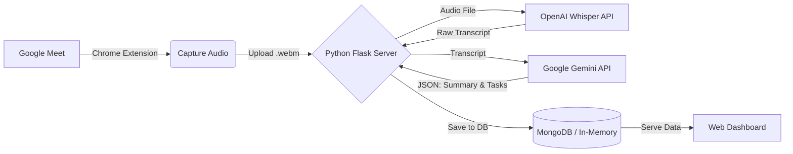

# AI Meeting Assistant 🎙️🤖

[](https://www.python.org/downloads/)
[](https://flask.palletsprojects.com/)
[](https://github.com/openai/whisper)
[](https://deepmind.google/technologies/gemini/)
[](https://developer.chrome.com/docs/extensions/)

*English / [Tiếng Việt](#hướng-dẫn-tiếng-việt)*

An intelligent tool designed to enhance productivity during online meetings. It captures audio directly from Google Meet using a Chrome Extension, transcribes the speech using **OpenAI Whisper**, and generates comprehensive summaries and action items using **Google Gemini AI**.

---

##  Key Features
- **Real-time Audio Capture:** A lightweight Chrome Extension (Manifest V3) that natively captures audio from Google Meet tabs without requiring bot participants.
- **Accurate Transcription:** Integrates OpenAI Whisper API for high-accuracy, multilingual speech-to-text conversion.
- **AI-Powered Summarization:** Leverages Google Gemini Pro to deeply analyze transcripts, extract key discussion points, and format them into readable summaries.
- **Automated Task Extraction:** Automatically identifies Action Items, assignees, and deadlines, transforming meetings into actionable workflows.
- **Intuitive Dashboard:** A sleek, vanilla HTML/JS dashboard styled with modern CSS to review meeting history, summaries, and tasks.

##  System Architecture


##  Tech Stack
- **Backend:** Python, Flask, Flask-CORS
- **AI Integration:** OpenAI API (Whisper), Google Generative AI (Gemini 2.5 Flash/Pro)
- **Frontend:** Vanilla HTML5, CSS3, JavaScript (Fetch API)
- **Extension:** Chrome Extension API (Manifest V3, tabCapture)
- **Storage:** MongoDB (PyMongo), Local Storage fallback, AWS S3 (Optional for audio backups)

##  Getting Started

### Prerequisites
- Python 3.9+
- Google Chrome Browser
- API Keys: OpenAI API Key & Google Gemini API Key

### 1. Backend Setup
1. Clone the repository and navigate to the backend folder:
   ```bash
   cd backend
   ```
2. Create and activate a virtual environment:
   ```bash
   python -m venv .venv
   # Windows:
   .\.venv\Scripts\activate
   # macOS/Linux:
   source .venv/bin/activate
   ```
3. Install dependencies:
   ```bash
   pip install -r requirements.txt
   ```
4. Configure Environment Variables:
   Create a `.env` file in the `backend` directory with the following variables:
   ```env
   PORT=3000
   OPENAI_API_KEY=your_openai_key_here
   GEMINI_API_KEY=your_gemini_key_here
   # MONGODB_URI=your_mongodb_uri (Optional)
   # AWS_ACCESS_KEY_ID=... (Optional)
   ```
5. Start the server:
   ```bash
   python app.py
   ```
   *The server and dashboard will run at `http://localhost:3000`*

### 2. Chrome Extension Setup
1. Open Google Chrome and go to `chrome://extensions/`.
2. Enable **"Developer mode"** in the top right corner.
3. Click **"Load unpacked"** and select the `chrome-extension` folder from this repository.
4. Pin the extension to your browser toolbar for quick access.

### 3. Usage Guide
1. Start the Python Backend (`python app.py`).
2. Join a **Google Meet** call in Chrome.
3. Click the AI Meeting Assistant extension icon and press **Start Recording**.
4. When the meeting ends, click **Stop Recording**.
5. The audio is automatically uploaded to the local backend, transcribed, and analyzed.
6. Open `http://localhost:3000` to view the comprehensive meeting summary and action items!

---

<br>

<h1 id="hướng-dẫn-tiếng-việt"> Hướng Dẫn Tiếng Việt 🇻🇳 </h1>

Một công cụ thông minh giúp tối ưu hóa hiệu suất trong các cuộc họp trực tuyến. Hệ thống thu âm trực tiếp từ Google Meet thông qua Chrome Extension, chuyển đổi giọng nói thành văn bản bằng **OpenAI Whisper**, sau đó tóm tắt và trích xuất các công việc cần làm bằng **Google Gemini AI**.

##  Tính năng nổi bật
- **Ghi âm trực tiếp:** Chrome Extension cực nhẹ (Manifest V3) bắt âm thanh trực tiếp từ tab Google Meet mà không cần bot tham gia cuộc họp.
- **Chuyển đổi văn bản chính xác:** Sử dụng OpenAI Whisper API cho khả năng nhận diện giọng nói tiếng Việt/tiếng Anh với độ chính xác cao.
- **Tóm tắt bằng AI:** Tích hợp Google Gemini Pro để phân tích sâu nội dung, rút ra các điểm chính của cuộc họp.
- **Tự động tạo Task:** Tự động nhận diện các "Action Items" (Công việc), người phụ trách và deadline, giúp quản lý công việc dễ dàng.
- **Dashboard trực quan:** Giao diện quản lý hiện đại, mượt mà được xây dựng bằng HTML/CSS/JS thuần.

##  Hướng dẫn cài đặt

### 1. Cài đặt Backend
1. Mở Terminal, đi tới thư mục `backend`:
   ```bash
   cd backend
   ```
2. Tạo và kích hoạt môi trường ảo:
   ```bash
   python -m venv .venv
   .\.venv\Scripts\activate
   ```
3. Cài đặt thư viện:
   ```bash
   pip install -r requirements.txt
   ```
4. Cấu hình file `.env`: Tạo file `.env` trong thư mục `backend` và thêm API Key của OpenAI & Gemini.
5. Chạy Server:
   ```bash
   python app.py
   ```
   *Truy cập Dashboard tại: `http://localhost:3000`*

### 2. Cài đặt Chrome Extension
1. Mở Chrome, truy cập `chrome://extensions/`.
2. Bật **"Developer mode"** (Chế độ dành cho nhà phát triển).
3. Bấm **"Load unpacked"** và chọn thư mục `chrome-extension` của dự án.
4. Ghim Extension lên thanh công cụ.

### 3. Cách sử dụng
1. Đảm bảo Backend Server đang chạy.
2. Tham gia cuộc họp trên **Google Meet**.
3. Bấm vào icon Extension và chọn **Start Recording**.
4. Khi kết thúc, bấm **Stop Recording**.
5. Mở `http://localhost:3000` để xem ngay bản tóm tắt và danh sách công việc AI vừa tạo ra!
